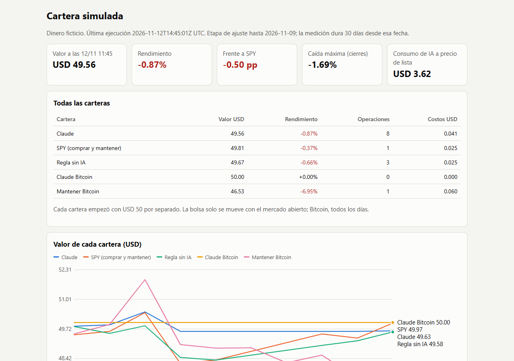

# Claude Trader: an LLM paper-trading experiment with hard risk limits

An autonomous **paper-trading** system (simulated money only) in which Claude analyzes the market and proposes trades, while plain Python code decides what actually runs. It manages a USD 50 simulated portfolio of US stocks and ETFs, plus a separate Bitcoin portfolio. Both are compared against simple benchmarks with the same simulated costs.

This repository holds the project overview only, not the source code.

[Full dashboard screenshot](screenshots/dashboard_full.png)

## How it works
| When (New York time) | What happens | Uses Claude |
|---|---|---|
| Every 15 minutes while the market is open | Checks prices, stops, targets and the loss kill switch | No |
| 10:15 and 15:30 | Full analysis of the market, news, the portfolio and candidate trades | Yes |
| After a sharp SPY drop, a VIX spike or a risk headline | Extra analysis, at most 2 per day | Yes |
| 16:20 | Closing value, dividends, books check and report | No |
| End of the week | Weekly review with proposals, not applied automatically | Yes |

Each analysis follows the same steps:
1. The program gathers prices, indicators, rates, volatility, news and calendars.
2. Claude writes a thesis note for each new candidate, then decides, with limited web search and no file or shell access.
3. **A second Claude instance tries to refute every buy.** It can reduce or veto a trade, never increase it.
4. The program re-checks prices and applies the risk limits, and only trades that pass go to the simulated broker.
5. If data or Claude fails, the system does not buy. Stops keep working without Claude.

## Risk limits the AI cannot override
- Long only, with no leverage and a fixed universe of 46 assets.
- Position caps by asset type and sector, and at most 6 positions.
- A maximum risk of 1.5% of capital per trade, measured to the stop.
- The maximum exposure depends on the market regime (100%, 70%, 35% or 10%).
- No buys within 3 sessions of a company's earnings report, and no buys on stale quotes.
- Kill switches: no new buys at -3% for the day or -6% for the week, limits halved at -10% from the peak, and a full exit at -15%.
- The live broker adapter refuses any URL that is not a paper-trading endpoint.

## Benchmarks
- **Stocks:** Claude against buying and holding SPY, and against a no-AI rule that holds the top 3 ETFs by 6-month momentum above their 200-day average, with the rest in short-term bonds.
- **Bitcoin:** Claude, which can hold Bitcoin or cash with Binance-like costs, against buying and holding Bitcoin.
- **AI cost:** the dashboard also shows what the AI calls would cost at list price.

## Engineering highlights
- An LLM is used as an analyst, not as an executor: it suggests, a second model challenges and deterministic code decides.
- Shared lessons: each analysis can leave a one-line note about its own process, and both portfolios read these notes before deciding.
- Each portfolio runs as its own scheduled Windows task with its own database, so a failure in one doesn't affect the other.
- Pure Python standard library, SQLite and about 120 unit tests. A static HTML dashboard is generated after each run.

## Status
Run as a time-boxed experiment in November 2026, then paused. With only a few weeks of data, the results don't separate skill from luck, and the project never claims they do.

## Contact
Built by **Andino Works**. More projects: [andinoworks.github.io/portfolio](https://andinoworks.github.io/portfolio/)
